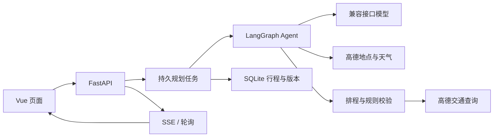

# 架构

本页描述当前代码结构。整理日期：2026-10-22；历史实现与测量记录见[归档](archive/README.md)。

## 总体结构

模型负责候选选择、顺序和建议停留；程序负责按 POI ID 回填地点、处理约束、计算时间、保存版本。地图证据、模型建议和用户填写的数据保持来源区别。

## 新行程链路

1. 首页读取自然语言、详细设置或攻略来源，核对城市、日期、人数和预算口径。
2. 页面使用稳定的 `request_id` 提交后台任务。服务端完成容量检查和幂等接收，再返回任务状态。
3. Agent 选择景点、酒店、天气等工具；同轮独立查询可以并行。工具原始证据保留在服务端，模型只接收精简投影。
4. 模型输出地点 ID、建议时长与游览重点。程序从已查询候选回填名称、坐标等，并按路线匹配餐厅。
5. 初稿做有界分区、顺序和密度预筛；真实路线查询后，计算交通、等待、用餐、缓冲、营业窗口、固定预约和入场时间段。
6. 冲突触发有界本地调整或模型 patch。保留明确要求，无法解决时返回带冲突的草稿，不伪装通过。
7. 补充费用参考后，在同一事务中保存旅行结果并标记任务成功。页面通过 SSE 获取进度，断开时退回轮询。

## 修改与恢复

手动编辑、DIY、Agent 修改和调整方案均携带 `base_version`。服务端重新检查约束，并校验发生变化的日期；未变日期复用服务端已有时间表，不信任客户端伪造的校验结果。版本冲突返回 409。

预览不保存版本；采用后新增可撤销版本。恢复旧版本也会产生新版本，保留修改历史。跨日修改和自动初稿调整有不同的保护范围，见[核心设计](CORE_DESIGN.md)。

入场时间使用单独的 `entry-preview` / `entry-timing` 接口，只接收日期、景点标识、时间约束与方案选择。服务端检查 owner 和版本，从自身保存的交通重建时间线；原时间线不一致或缺失时降级为交通待核实，不接收客户端的可行性结论。预览及保存均不调用模型、地图或票务供应商。

`entry-options` 至多生成两项同日换序和一项可选的灵活景点跨日移动，最多检查 24 条变化路段、总预算约 24 秒，单项交通等待上限 8 秒。`entry-option` 只接收候选标识并在服务端重新生成、检查和保存，不能上传一张“已通过”的时间表绕过校验。无数据和未通过的方案不允许采用。

门票预订是计划级 `ticket_bookings` 账本：独立接口写入用户自报的总额、人数、渠道与退款，按日期、访问标识和地点指纹绑定。预算聚合一次计入整笔净支出，未覆盖人数继续使用参考价；取消后保留未退款支出并恢复仍计划参观的门票参考费。普通编辑、Agent 与仓库提交层保留服务端账本，活动记录阻止删除、替换和跨日迁移已预订景点；恢复历史版本是用户明确的整体回退。

## 主要模块

路径均相对仓库根目录。

| 层次 | 代码 | 职责 |
| --- | --- | --- |
| 页面 | `frontend/src/views/Home.vue`、`Result.vue` | 需求输入、恢复任务、逐日阅读、地图、编辑和助手 |
| 前端服务 | `frontend/src/services/trips.ts` | 保存接口、任务跟踪、SSE 与轮询降级 |
| API | `backend/app/api/routes/saved_trips.py` | 任务、行程、版本、检查、准备清单及方案接口 |
| Agent | `backend/app/agents/travel_agent.py` | 工具循环、证据回填、patch、有限修复 |
| 任务 | `planning_runs.py`、`run_leases.py`、`queue_admission.py` | 接收、租约、执行、取消和恢复 |
| 排程 | `schedule_validator.py`、`schedule_solver.py`、`opening_hours.py` | 真实交通、约束、求解和营业时间解析 |
| 调整 | `initial_planning.py`、`meal_timing.py`、`conflict_fix.py` | 初稿、三餐和冲突方案的有界调整 |
| 事实与费用 | `fact_evidence.py`、`place_facts.py`、`cost_breakdown.py`、`hotel_quotes.py` | 来源、刷新、参考小计与用户酒店报价 |
| 供应商 | `amap_rest.py`、`provider_limits.py`、`request_gate.py` | 查询、共享限速与 HTTP 资源协调 |

表中后端服务文件位于 `backend/app/services/`。旧规划引擎和同步接口仍存在，默认 Agent 是当前主要流程。

## 存储

`backend/var/` 保存运行数据：`trips.sqlite3` 包含旅行、版本和规划任务；`agent-checkpoints.sqlite3` 保存图状态；其余 SQLite 文件用于路线缓存与资源协调。浏览器保留当前旅行及待恢复任务标识。

当前实现以本地 SQLite 和共享文件协调为基础。浏览器 owner token 是记录访问凭据，不是完整账号系统；同部署多进程机制不等于跨主机部署已经验收。
