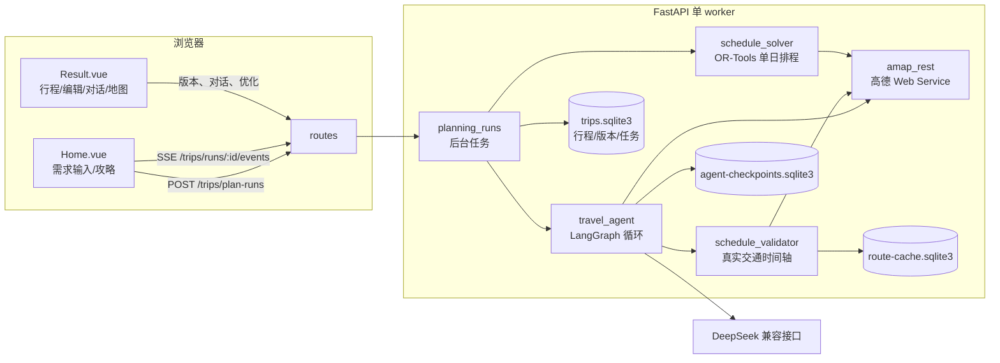
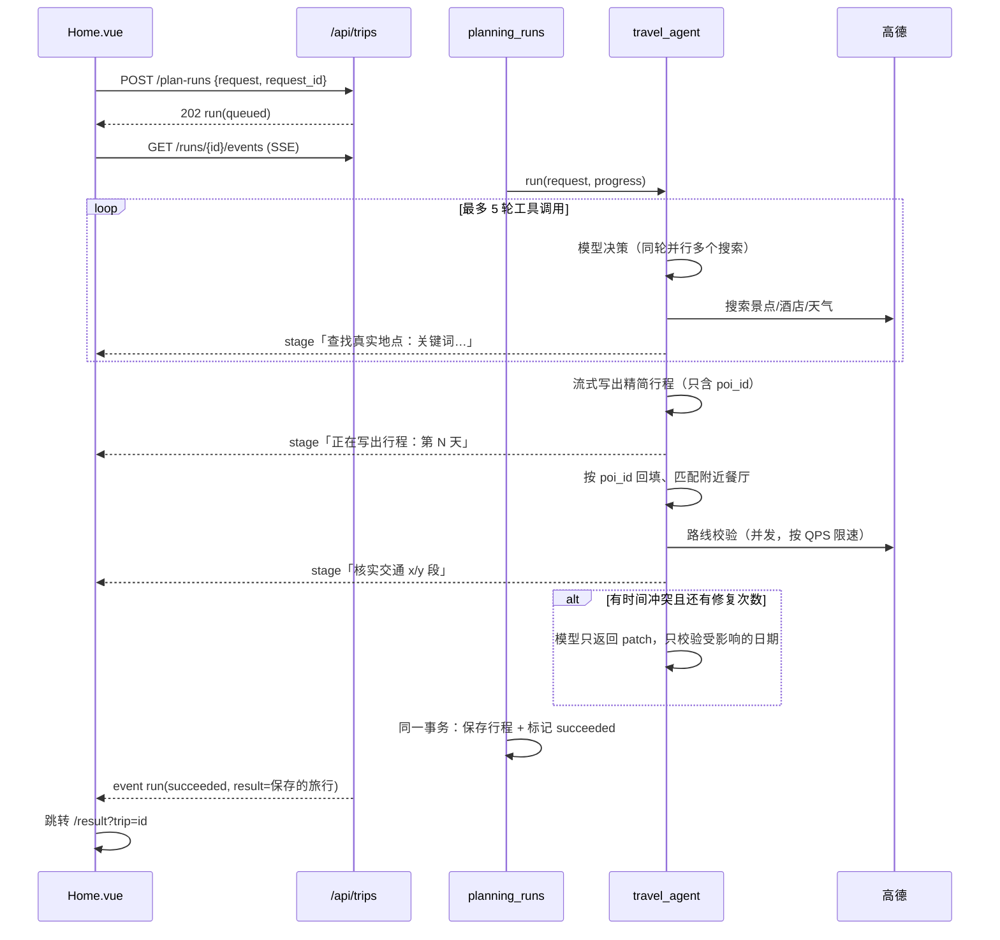

# 架构说明

更新日期：2026-10-10（含拖拽编辑与天气建议）。本文描述当前代码的结构和关键数据流。每轮迭代的设计取舍见同目录下带日期的调研与实施记录。

## 总览



本地只运行一个 uvicorn worker。限速、正在进行的请求合并、任务通知都在进程内完成；多 worker 或多实例部署需要共享队列和限流，目前不支持。

## 后端模块

| 层 | 文件 | 职责 |
| --- | --- | --- |
| 入口 | `api/main.py` | lifespan：启动时恢复未完成任务并校验配置；关闭时停止任务、释放高德连接 |
| 路由 | `api/routes/trip.py` | 需求理解 `/trip/intake`、旧的同步生成 `/trip/plan`、攻略链接与截图提取、地点推荐、DIY 候选 |
| | `api/routes/saved_trips.py` | `/trips`：保存、版本、恢复、校验、后台任务（新建 / 对话 / 优化，优化可一次处理多个日期）、SSE 事件流、天气检查 `GET /{id}/weather`；`X-Trip-Owner` 标识区分用户 |
| | `api/routes/poi.py`、`map.py` | 地点详情与搜索、配图（优先用高德 POI 照片）、地图辅助接口 |
| Agent | `agents/travel_agent.py` | 默认引擎：“模型 → 工具 → 校验/修复”的有界循环 |
| | `agents/trip_intake.py` | 把自然语言需求整理成结构化表单（用快速模型） |
| | `agents/langgraph_planner.py` | 模型构建（`build_chat_model`）、地点落地、餐饮按路线匹配、JSON 兼容解析；同时保留旧的固定并行引擎 |
| | `agents/trip_planner_agent.py` | 旧的 HelloAgents 引擎（`PLANNER_ENGINE=helloagents`） |
| 服务 | `services/planning_runs.py` | 持久化后台任务、进度写入、SSE 通知、取消、重启后恢复 |
| | `services/trip_repository.py` | SQLite（WAL）：行程、版本、任务；`base_version` 乐观锁；生成结果与任务完成状态在同一事务中提交 |
| | `services/amap_rest.py` | 共享 HTTP 连接、按时段预约的路线限速、地点搜索缓存、POI 照片 |
| | `services/schedule_validator.py` | 按真实路段生成每日时间轴；内存 + SQLite 路线缓存；回报“已核实 x/y 段” |
| | `services/schedule_solver.py` | OR-Tools 时间窗排程（单日），有查询预算 |
| | `services/plan_patch.py` | 结构化的局部修改；只重新校验发生变化的日期 |
| | `services/plan_quality.py` | 独立的质量报告：必去覆盖、交通覆盖、时间冲突 |
| | `services/observability.py` | 模型调用耗时与缓存命中日志、流式进度、可选的 Langfuse 回调 |
| | `services/weather_advice.py` | 只读的天气检查：短期预报中有雨雪的日期，为未锁定的户外景点查找 5 公里内的室内候选（博物馆、展览馆、美术馆、科技馆、商场） |
| | `services/place_facts.py` | 地点事实与价格来源：把高德的餐厅人均价、酒店最低价、评分、开放时间写入地点；用快速模型估算门票（标注“模型估算，未核实”）；用户填写的价格不覆盖，高德价格优先于模型估算；从开放时间文本中识别闭馆日 |
| | `services/plan_checks.py` | 规则校验（不调用模型或网络）：重复景点/餐厅、缺午晚餐、单日景点过多、超长停留、坐标越界或离行程中心超过 80 公里、缺住宿与换酒店、用户写明的预算与已知费用对比；结果并入 `plan_quality` |
| | `services/trip_prep.py` | 出行准备：按场馆类型推断的预约提醒（提前 7 或 3 天）、固定预约确认、按酒店合并的住宿晚数、按户外景点与短期预报生成的打包清单 |
| | `services/conflict_fix.py` | 时间冲突的调整方案：去掉一个可选景点（最多 3 个候选），或按比例缩短可选景点的停留时间（每个不少于 45 分钟）。每个方案都用真实路线重新校验，可行的排在前面；必去、锁定和已预约的景点不改。接口 `POST /trips/{id}/days/{date}/fixes` 不修改行程，用户采用后才保存为 `fix` 版本 |
| | `services/reference_service.py`、`place_recommendations.py` | 攻略地点提取、推荐候选排序（只排序高德候选，未知 ID 丢弃） |

## 新建行程的数据流



要点：

- **模型只决定选什么**：选哪些地点、什么顺序、停留多久。名称、地址、坐标由程序按 `poi_id` 从搜索结果回填；餐厅由程序按当天路线匹配。未经搜索的 `poi_id` 会被拒绝，并反馈给模型重试。
- **修复范围有边界**：新建行程出现时间冲突时，模型拿到冲突日期的 `item_id` 列表，只返回 patch，最多修复 2 次。修复次数用完仍有冲突时，返回带冲突标识的草稿，不会把它说成可行。
- **刷新不丢失**：`request_id` 保存在 localStorage（`pendingPlanRun`），首页挂载时会自动接回进度。任务和 Agent 检查点都在 SQLite 中，服务重启后会继续执行。
- **对话和单日优化**沿用 `/trips/{id}/runs`，进度同样走 SSE；SSE 断开时前端自动退回 1.5 秒轮询。

## 拖拽编辑与局部重排


- 变动日期指景点、餐饮或酒店的增删或顺序发生变化的日期；只修改文字或费用时不会触发优化。
- 锁定或有固定预约的景点不能拖动或跨日移动，求解器也会保持它们的位置。
- 多个日期的优化放在同一个任务里执行，最后生成一个版本；结果里的 `optimization.days` 列出每天的求解状态。

## 天气感知替换

- `GET /trips/{id}/weather` 只读：读取高德短期预报（约 4 天）；对有雨、雪、雷、冰雹、沙尘、霾的日期，按高德分类（缺失时按名称）判断景点是室内还是户外。
- 只为未锁定、没有预约的户外景点给出最多 3 个附近的室内候选，并排除行程里已有的地点。
- 超出预报范围的日期显示“暂无预报”；不会推测远期天气。
- 新生成的地点和对话中新增的地点都会保留高德分类，便于判断室内户外。旧数据没有分类时按名称判断，判断不出来就不给建议。

## 规则校验与评测

- `GET /trips/{id}/checks` 返回规则问题，分为 error、warning、info 三级。结果页把 error 和 warning 并入“行程可靠性”，info 折叠显示为“小提示”。每次版本变化后都会重新读取。
- `GET /trips/{id}/prep` 返回出行准备清单。预约提醒只按场馆类型推断，不声称某个场馆的具体规则；勾选状态只保存在当前浏览器。
- `backend/eval/run_eval.py`：
  - `score`：离线给 `var/trips.sqlite3` 中的全部行程打分，不调用接口。
  - `run`：用 `eval/cases.json` 中的 12 个中文用例真实生成行程，记录耗时、模型调用次数、输出 token、缓存命中率、路线覆盖、时间冲突、规则问题，以及用例声明的硬约束（每日景点上限、排除/包含关键词、预算）。
  - 结果写入 `eval/results/`，该目录已被 git 忽略。

## 模型调用与缓存

- 系统提示和工具定义在每一轮都保持不变（最终轮使用 `tool_choice="none"`，不切换模型），动态内容只追加在后面，使 DeepSeek 的前缀缓存能够命中。需求理解提示把“今天日期”放在末尾，也是出于同样的考虑。
- `build_chat_model` 统一设置 temperature（默认 0.3）、超时（`LLM_TIMEOUT`，默认 90 秒）、重试次数（`LLM_MAX_RETRIES`，默认 1）以及流式用量统计。
- `LLM_FAST_MODEL_ID` 可选，用于需求理解、攻略地点提取、推荐排序；留空时沿用主模型。
- 每次模型调用都会打印耗时、输入、缓存命中和输出 token；配置 `LANGFUSE_*` 并安装 `langfuse` 后，还会上报完整链路。

## 高德查询与缓存

| 项 | 当前做法 |
| --- | --- |
| HTTP 连接 | 每个事件循环共享一个 keep-alive 的 `httpx.AsyncClient` |
| 路线限速 | 按 `AMAP_ROUTE_QPS` 预约时段；等待时不持锁，并发路段按速率排队 |
| 路线明细 | 公交方案保存逐段换乘（`RouteLeg`：步行 / 地铁 / 公交 / 铁路 / 驾车，线路与方向、上下车站、进出站口、站数、可替代线路）、票价 `fare`、打车参考价 `taxi_cost`，以及压缩后的轨迹 `polyline`（最多 160 个点，保留 5 位小数）；1 公里以内直接查步行 |
| 路线缓存 | 内存 LRU 512 条 + SQLite，`ROUTE_CACHE_TTL_SECONDS` 默认 6 小时；同一进程内的重复请求会合并；结果带查询时间 |
| 地点搜索缓存 | 内存 1024 条，6 小时；使用 `extensions=all`，同时取回 `biz_ext` 中的人均价、最低价、评分、开放时间 |
| 地点限速 | 地点搜索和详情按 `AMAP_POI_QPS`（默认 3）单独限速，限流错误最多重试 3 次 |
| 失败处理 | 网络或限流错误最多尝试 3 次；密钥、权限、额度错误不重试；公交无方案时只接受 2 公里以内的真实步行路线；从不用直线距离代替交通时间 |

路线校验的耗时大致等于“路段数 / QPS”。这是当前最主要的耗时，确认账户配额后调高 QPS 的效果最直接。

## 数据存储（`backend/var/`）

| 文件 | 内容 |
| --- | --- |
| `trips.sqlite3` | `trips`（当前行程与对话）、`versions`（每个版本及其差异摘要）、`planning_runs`（任务状态、进度、预备结果、最终结果）。新建任务的 `trip_id` 在成功时回填 |
| `agent-checkpoints.sqlite3` | LangGraph 检查点，用于中断后继续执行 |
| `route-cache.sqlite3` | 路线缓存 |

## 前端

页面结构（2026-10-10 重排）：

```
结果页
├─ 头部：城市、日期、天数/景点/餐数/已知费用 · [编辑行程] [问助手] [更多 ⋯]
│        编辑时变为：编辑中 · 撤销一步 · 取消 · 保存修改
├─ 状态条 ResultStatus：只列需要处理的问题，每条带“去第 N 天 / 重新校验”
├─ 本次修改（带“撤销这次修改”）、修改记录、出行准备、天气（按需展开）
├─ 主栏 .main-content
│   ├─ 日期标签（可接收拖拽，跨日移动）
│   ├─ 当天卡片：标题 + 天气 + [优化这一天] [推荐地点 ▾] → 排列面板（编辑时）→ 时间线 → 地点详情
│   └─ 补充信息标签页：整体建议 / 费用 / 攻略来源 / 数据来源说明（免责说明只在这里出现一次）
└─ 右侧固定栏 .result-aside（≥1024px）：当天地图 + 旅行助手 AgentPanel
   窄屏：地图排在主栏后面，助手变为底部抽屉，由右下角“问助手”按钮打开
```

- `views/Home.vue`：需求输入、攻略导入、草稿卡片、“我的旅行”。有已保存的旅行时，顶部显示“继续上次的旅行”。生成时通过 `startCreateRun` 和 `watchRun` 显示实时阶段，可以取消。
- `views/Result.vue`：页面编排与状态。地图只显示当前日期，按时间线顺序给停靠点编号（酒店标“宿”），沿真实轨迹画路线（乘车为实线，步行为虚线，没有轨迹时用淡色直线表示顺序）；切换日期只替换标记，保存后也不重建地图。地图使用 2D 模式并关闭键盘操作，避免 3D 模式在按键时报 NaN 像素错误，也避免和日期标签的方向键冲突。
- `components/ConflictFixPanel.vue`：状态条中点“给出调整方案”后显示已校验的方案，点“采用”即保存。
- `utils/route.ts`：换乘文字与高德导航链接（时间线和出行手册共用）；`utils/handbook.ts`：导出单文件离线手册（含每站导航链接、换乘步骤、开放时间，适配手机和暗色模式），以及 .ics 日历（Asia/Shanghai 时区，每个有时间的停靠点一个日程，按 RFC 5545 折行）。
- `components/AgentPanel.vue`：助手对话（桌面固定在右侧，窄屏为抽屉），Enter 发送。
- `components/ResultStatus.vue`：状态条。
- `components/DayArrange.vue`、`DayTimeline.vue`、`WeatherAdvicePanel.vue`、`TripPrepPanel.vue`、`CostInput.vue`、`ReferenceCards.vue`、`TripLibrary.vue`：分别负责排列、时间线、雨天备选、出行准备、价格输入、攻略卡片、旅行列表。
- `services/trips.ts`：保存相关接口、`watchRun`（用 fetch 读取 SSE，以便带上 `X-Trip-Owner` 头；失败时退回轮询）。`services/api.ts`：需求理解、旧的同步接口、攻略提取等。
- 构建：Ant Design 组件通过 `unplugin-vue-components` 按需引入（类型声明自动生成在 `src/components.d.ts`），结果页专用的组件进入结果页分包。Vue、地图加载器单独分块；html2canvas 和 jspdf 按需加载。
- 已移除：左侧导航、手机端标签导航、统计卡片、装饰性标题与动效开关（日期切换动效改为跟随系统的“减少动态效果”设置）、每天单独的迷你路线地图（交通耗时已在时间线中显示，右侧地图也跟随日期）。

## 已知边界

- 只支持单 worker 本地部署；多实例需要共享限流、任务队列和租约。
- 营业时间、预约名额、实时票价还没有接入官方数据源；交通结果是查询时的数据。
- 跨日自动分配、可选地点的自动取舍还没有实现；求解范围有限，不代表全局最优。
- 浏览器随机标识不等于账号认证；多人使用前需要接入正式认证。
