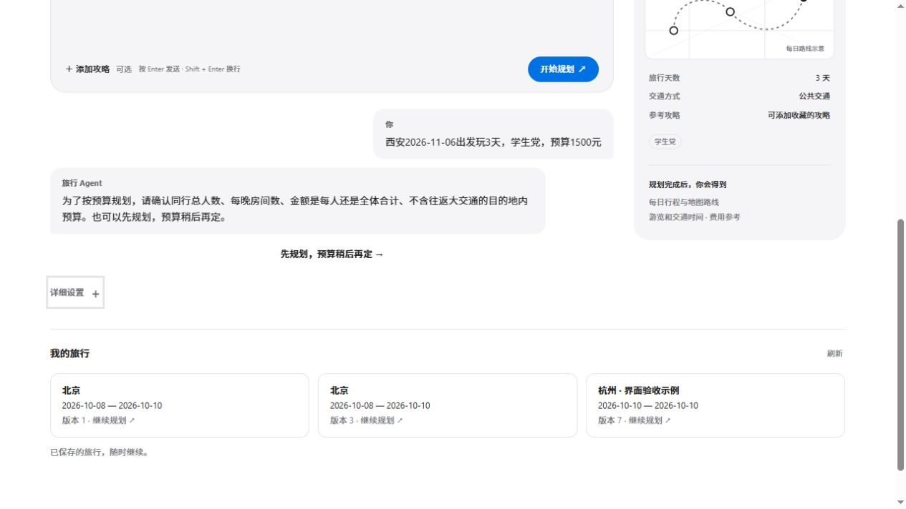

# 对话预算、计价条件与日期核对

## 问题与行为

原先自然语言入口不传递人数、房间数和明确的目的地预算。后端已能按成人参考口径计价，但从对话进入规划时会丢失这些条件。“学生党，预算1500元”也无法直接证明这是几个人、是否包含往返。

这批改动完成以下链路：

- 需求理解提取总人数、每晚房间数、原金额、每人/全体和目的地内/含往返的范围；计价字段需要可在用户消息中找到的原话支持，助手举例不作为确认。
- 范围不明先追问；只有明确目的地内的预算才进入 `destination_budget`。人均金额乘以人数由程序用 Decimal 计算，模型不能自行把总额当原金额。
- 显式填写的表单条件进入理解上下文，新的描述优先。明确 null 清除旧字段；较旧服务缺少字段时兼容保留手工填写值。
- 用户可选择“先规划，预算稍后再定”。`budget_mode=deferred` 进入表单、请求和保存序列化；计算继续展示参考费用，但不把旧原文金额重新当限制，也不判断预算达标。默认 Agent 收到相同语义说明。
- 待澄清状态与最近对话保存在当前标签页的草稿中；空白重发、刷新或改用详细表单提交不会绕过追问。明确填写完整计价字段或主动暂缓可继续，不新增一次无意义模型调用。
- 费用页支持按本次试算条件暂缓预算比较；它仍是只读预览，不保存或修改旧旅行。
- 一日行程不为预算追加房间数问题；没有总预算需求时保留原来的快捷规划路径。单餐、房价等局部预算不升级为整趟预算。

## 日期问题也纳入验证

第一份真实模型记录 `backend/eval/results/budget-intake-20261016-214235.json` 的预算字段9/9符合预期，但当时断言没有覆盖日期。人工检查发现 ambiguous、no_budget、partial_meal 三例将“玩3天”输出为4天，因此不能把这份记录称作完整需求理解通过。

现在明确的“玩3天”“三天游”等有限表达由程序核对天数，按包含出发当天推算返程日，避免模型加一天的错误。新的天数修改优先于客户端附带的旧表单日期；新明确返程日期也优先于旧消息中的天数。明确日期范围与天数冲突时追问。模型提示要求仅给出发日与天数时不自行填写返程日。

这是有界中文表达解析，不是对任意自然语言或相对日期都已验证的承诺。

## 验证

- 后端全量320项通过，15.943秒，日志 `backend/var/budget-intake-regression.log`。覆盖预算范围、助手示例隔离、原话校验、非法数值、家庭人数、人均运算、暂缓/恢复、单日、单项预算、旧字段清除、日期冲突与修改优先级等。
- 前端22项测试通过，含5项新的费用条件传递与追问保护测试；`npm run build` 通过。仍有原有的大包提示，不能据此声称加载性能达标。
- 加强后的真实模型记录 `backend/eval/results/budget-intake-20261016-214818.json`：相同9例，城市、起止日期、天数与预算预期全部符合。每例单次调用0.77–1.74秒，仅为该次需求理解测量，不是整趟规划延迟、p95或生产准确率。
- 可从 backend 运行 `venv/Scripts/python.exe -X utf8 -m eval.budget_intake_eval` 重现真实模型验证。只用公开合成消息，不创建行程或任务。
- 只读真实服务验证：已有北京 v3 的 checks、deferred/active 两种费用预览均返回200；deferred 返回 limit=null，active 保留未知费用并返回 incomplete，没有虚构完整报价。
- 浏览器实测：输入11月6日出发玩3天、学生党预算1500元，显示11月6–8日和范围追问；人数、房间数、目的地总预算输入保持空白。空白再次点击只提示补充，不创建任务；刷新后原对话和暂缓入口仍在。费用页勾选暂缓后重新测算，显示未知费用和“不判断预算是否满足”。为避免生成用户旅行，没有在浏览器点击最终暂缓规划按钮；该路径的需求理解、字段传递和请求序列化分别有上述真实样例和回归覆盖。验收截图：。
- 原库仍为6个旅行、15个版本、3个历史规划任务、0个活动任务。内容哈希仍为 `a2268f23f077cf8b59d1a4a4f2657b7827ba1024f9450f7ad2686f27d58a44fa`。运行审计在 `backend/var/budget-intake-runtime-audit.json`；原用户行程未修改。

## 未完成项

预算明确不代表价格完整或可预订，也不能据此把之前西安评测改成预算通过。实际价格缺失、优惠、官方开放/预约信息、代表性负载下的整趟规划延迟、正式认证和生产部署仍需继续验证。完整12城评测与这9个需求理解样例属于不同范围，不合并计算通过率。
