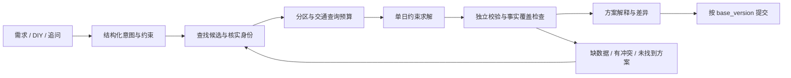

# Trip Planner 内核调研与改进设计

调研日期：2026-10-09。星数为本次 GitHub 页面显示值，存在页面缓存且会变化。依据为项目官方仓库、文档和当前工作区源码；这是设计建议，尚未实现。本文补充 NEXT_ITERATION_DESIGN.md，旧文档中的历史缺口不应当作当前状态。

## 结论

保留 Vue / FastAPI / LangGraph，在现有内核上补齐「统一地点证据、约束求解、局部修改、持久任务、评估」五层。模型负责理解偏好、查找候选和解释方案，程序负责地点身份、时间计算、约束、版本提交。优先解决“排出来但走不完”和“改一处重写全计划”。

本次筛选到的高星项目主要提供通用 Agent 和优化能力；旅行专项论文项目作为补充，不把旅行 demo 当作成熟生产方案。

## 值得借鉴的项目

| 项目 | 页面星数 | 核实的能力 | 本项目取舍 |
| --- | --- | --- | --- |
| [LangGraph](https://github.com/langchain-ai/langgraph) | 42.9k | 图状态持久化、会话状态、人工介入 | 已使用，补齐 checkpointer 与运行任务；无需换框架 |
| [Deep Agents](https://github.com/langchain-ai/deepagents) | 30.0k | 长任务规划、上下文管理、隔离上下文、可插拔工具 | 借鉴阶段规划和证据摘要；暂不整体迁移或默认堆叠多个 Agent |
| [GPT Researcher](https://github.com/assafelovic/gpt-researcher) | 30.0k | 资料检索、汇总、带引用的研究报告 | 让地点事实关联来源；开放时间、预约规则另查官方来源 |
| [Pydantic AI](https://github.com/pydantic/pydantic-ai) | 20.5k | 类型化输出、输出验证与重试预算 | 借鉴类型契约；在现有 LangGraph 中实现，无需再引入完整框架 |
| [OR-Tools](https://github.com/google/or-tools) | 14.2k | 时间窗路线问题、可选节点与舍弃代价 | 新增独立排程求解模块，先解决单日，再做跨日分配 |

两个旅行专项补充：

- [ITINERA](https://github.com/YihongT/ITINERA)，68 星：需求拆解、POI 候选、空间聚类和顺序优化。已查看 [spatial.py](https://github.com/YihongT/ITINERA/blob/main/model/spatial.py)：使用坐标距离聚类与 TSP 排序。可以借鉴分区思想，但坐标距离不能代替北京公交或驾车耗时；不直接复制其实现。
- [TravelPlanner](https://github.com/OSU-NLP-Group/TravelPlanner)，553 星：多约束旅行规划基准，区分环境、常识与硬约束，并提供评估代码。借鉴评估维度，建立自己的中国城市样例；其数据库不是实时高德或国内预约数据。

进一步依据：

- [LangGraph 持久化](https://docs.langchain.com/oss/python/langgraph/persistence)：checkpointer 保存图状态，store 管理跨会话资料。业务行程版本仍单独保存。
- [Pydantic AI 输出与验证](https://pydantic.dev/docs/ai/core-concepts/output/)：结构化输出和业务验证分层，重试有明确预算。
- [OR-Tools 时间窗示例](https://developers.google.com/optimization/routing/vrptw)：使用地点之间的耗时矩阵和访问时间窗。
- [OR-Tools 可选节点](https://developers.google.com/optimization/routing/penalties)：以舍弃代价控制可选地点；必去项不能仅设一个很大的软惩罚。
- [TravelPlanner 硬约束评估](https://github.com/OSU-NLP-Group/TravelPlanner/blob/main/evaluation/hard_constraint.py)：可参考约束检查的组织方式，但不照搬名称匹配或价格数据。

以上是参考项目的事实；下文是针对本项目提出的设计，不代表这些仓库已经提供国内旅行的完整解决方案。

## 当前内核的具体缺口

| 当前源码 | 已有能力 | 仍需改善 |
| --- | --- | --- |
| `agents/travel_agent.py` | 工具查询、地点落地、必去约束、限定修改日期、最多两次校验修复 | 通过文本截取解析 JSON，主要输出完整 TripPlan；校验冲突后要求模型重写，修复用尽仍返回带冲突草稿 |
| `services/schedule_validator.py` | 真实路段耗时、预约检查、缓冲、超时提示 | 是校验器，未搜索可行顺序；午餐按景点数量中点插入，零食统一在景点后，缺少自由时间轴 |
| `models/schemas.py` | 景点有 poi_id，费用区分未知与已知 | Meal / Hotel 没有统一 poi_id；ScheduleItem 身份含数组位置，不适合作为长期编辑锚点 |
| `TravelAgent.run()` | 本次调用内维护图状态 | 每次创建并 compile 图，未传 checkpointer；已保存结果可恢复，未完成运行不能靠业务版本恢复 |
| `services/place_recommendations.py` | 对地图候选排序，拒绝不存在的 ID，不自动修改计划 | 查询主题由少量关键词规则决定，难以处理“第二天附近适合雨天、不想再逛博物馆”等组合需求 |
| `services/amap_rest.py` 和校验缓存 | 限速、重试、进程内缓存 | 多进程不能共享限额；增加优化矩阵会放大请求量，必须先控制查询预算 |
| `services/trip_repository.py` | SQLite 版本、归属隔离、base_version 防覆盖 | 应继续保留，但业务提交与运行检查点是两种不同职责 |

当前已有真实交通、未知价格标注和 DIY 编辑，不应推倒重写。这里要补的是约束与执行的可靠性。

## 建议的执行链

LangGraph 调度阶段、保存检查点和事件；每个阶段使用明确输入输出。工具循环可保留在候选发现阶段，求解与提交阶段由程序控制。对无法解决的硬约束，给用户具体选择，不把模型重写作为无限循环。

### 1. 统一身份与证据

建议新增 `PlaceRecord`、`PlaceFact`、`VisitItem`：

- `PlaceRecord`：内部 place_id、provider、provider_poi_id、名称、城市、地址、坐标、查询时间。景点、餐厅、酒店共用。
- `PlaceFact`：字段、值、来源、查询时间、适用日期及证据状态。地点坐标已核实，不等于营业时间、票价和预约规则也已核实。
- `VisitItem`：稳定 item_id、place_id、kind、停留时长、允许时间窗、固定预约、锁定状态、必去/可选和用户备注。

用 item_id 标识一次访问，用 place_id 标识地点；同一家酒店的出发和返回是两个访问。按 POI ID 区分分店，旧数据缺 ID 时保留未匹配状态或重新核实，不凭名字合并。模型只能引用候选 ID；地点事实由程序装配。

### 2. 先做单日排程

新增 `schedule_solver.py`，与现有校验器分离。以 OR-Tools Routing 时间窗模型做原型，必要时为用餐选择、复杂预约引入 CP-SAT；是否采用哪种模型由固定样例验证决定。

硬约束：固定预约、必去地点、用户锁定的日期或顺序、当天起止、所选酒店锚点。软目标：少绕路、适当留白、偏好覆盖、少改原计划。推荐用餐窗口是可编辑的默认偏好，不冒充用户已确认的硬约束。

交通、停留和缓冲共同参与时间递推。可选地点允许舍弃并附原因，必去地点不得静默删除。确认营业时间后应限制“访问结束不晚于关门”；未知营业时间保留事实缺口，只能说明在已知时间假设下可行。

结果区分：`feasible_under_assumptions`、`insufficient_data`、`proven_infeasible`、`no_solution_within_budget`。求解超时或限制搜索未找到方案，不等于证明无解。冲突解释由独立诊断生成；求解器不会自动提供适合用户阅读的原因。

先固定每天已有候选求解，再迭代跨日分区和移动可选项。某天被明确指定修改时，只求解这一天；跨日调整需有明确意图。

### 3. 交通矩阵不能全量暴力查询

20 个节点全有向组合就有 380 条边，会显著放大现有高德限制。

先按区域和时间窗缩小候选，对固定预约、酒店和当前顺序相邻边优先查询；其余潜在边按预算逐步补齐。直线距离仅用于筛选搜索范围。求解器回调不能现场执行异步 HTTP 查询，应读取已准备的数据。

未知边禁止当作零耗时；原型可只在已核实边形成的子图中搜索，但结论必须注明搜索范围，不能据此宣称全局无解。缺数据时返回可继续核实的草稿。

新增 `RouteMatrixService`：按地点 ID、交通模式和查询上下文缓存，合并相同的进行中请求。单进程先保留本地方案；多 worker 部署前接共享限流和缓存。配额耗尽暂停任务并展示原因；QPS 故障有限退避，不能无限重试。出行日期不是查询日期，耗时仍需标注采样时间和预测局限。

### 4. 修改和推荐使用结构化操作

建议意图：`answer_question`、`recommend_places`、`add_visit`、`replace_visit`、`remove_visit`、`reorder_visits`、`relax_day`。输出类型化 `PlanPatch`，携带 base_version、目标 item_id、目标日期和候选 ID。

程序检查权限、版本、锁定项及证据，应用到副本，仅重算受影响日，生成 diff，再复用现有版本提交。旧 API 可暂时继续返回完整 TripPlan 给前端，内核不再要求模型重写完整事实对象。

“再问 Agent”先生成有限的检索计划，比如雨天偏好、当前区域、排除已去地点；查询失败或不足时可换关键词一次，仍受调用预算限制。推荐说明相关性、相对位置和需要核实的事项，选择后才修改。候选排序也可结合插入路线的已知成本；没有真实耗时时不写具体节省分钟数。

### 5. 持久执行与评估

新增 `PlanningRun`：run_id、owner、trip_id、base_version、阶段、状态、预算、事件序号、错误类型。图接持久 checkpointer，使用服务端生成并校验归属的 thread_id。提交节点用幂等键避免恢复后重复创建版本。

运行状态和业务版本分开；取消、服务重启及 SSE 重连有真实状态。对外事件只显示“正在查找地点 / 核实交通 / 调整路线”等工作进度，不输出内部推理。外部查询的恢复重放策略、结果缓存与幂等必须设计，不能只加 checkpointer 就承诺所有调用不会重复。

参考 TravelPlanner，建立自己的固定数据集：预约冲突、跨区折返、慢节奏、餐厅与酒店替换、同名分店、交通缺失、配额失败、仅修改一天、求解超时、任务恢复及并发提交。用确定性检查器验收，再补少量模型实测。

核心指标：硬约束违规数、必去覆盖率、事实来源覆盖率、可行方案比例、局部修改越界率、未知信息被误标已知的次数，以及模型/地图调用数、耗时、缓存命中与故障恢复结果。覆盖率不是只数非空字段；要检查来源和适用范围。

## 实施顺序与验收

| 阶段 | 落点 | 验收 |
| --- | --- | --- |
| A：身份、结构化修改、质量状态 | schemas、地点证据服务、PlanPatch、统一提交入口 | 三类地点保留 ID；同名分店不串；换一家餐厅不改其他天；冲突草稿不显示为成功通过 |
| B：单日求解、交通预算 | route_matrix、schedule_solver、独立 validator | 固定样例满足预约/日终/必去；可选删减有解释；未知边不变成 0；超时不报无解；查询有上限 |
| C：持久运行与诊断 | LangGraph checkpointer、run_repository、SSE、幂等提交 | 重启可继续或准确报告不可恢复；断线不重复提交；取消停止后续查询；旧 base_version 不覆盖新编辑 |
| D：分日与推荐改进 | 区域候选、跨日分配、检索计划、评估数据集 | 缓解折返；限定日期的修改不越界；推荐均有地点证据；与现有方案比较质量和调用成本 |

建议下一轮先完成 A，并用一个真实北京单日案例验证 B 的原型。身份和数据边界先稳定，优化器才能可靠处理餐厅、酒店与 DIY。无需为此迁移前端、接入多个完整 Agent 框架或复制论文仓库。

本轮只新增此调研文档，未更改应用代码、调用用户行程的外部服务或修改已保存行程。
