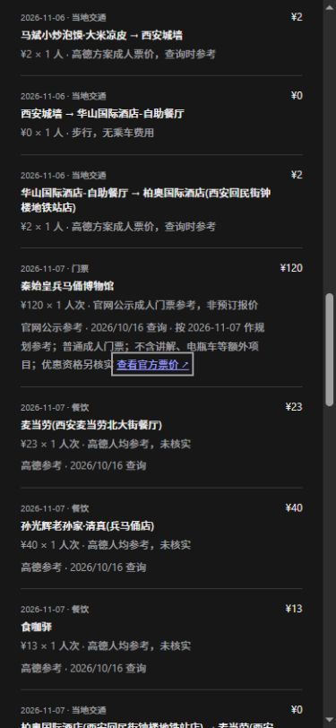

# 官方门票参考来源与日期范围

## 实际改动

新建持久任务、原同步规划接口和“补充价格与开放时间”现在先查询已支持场馆的官方成人门票政策，再对其余未知门票沿用明确标记的模型估算。不将官网公示标成预订报价，也不改变官方开放/预约余票尚未核实的状态。

第一批适配两个场馆：

| 场馆 | 官方页面 | 本次实际解析 | 计价范围 |
| --- | --- | --- | --- |
| 故宫博物院 | [票务政策](https://www.dpm.org.cn/singles_detail/257830.html) | 旺季60元、淡季40元；按游览日期选择 | 成人大门票；珍宝馆、钟表馆等另售项目未计，优惠资格另核实 |
| 秦始皇兵马俑博物馆 | [官方票务说明](https://www.bmy.com.cn/jingtai/bmyweb/ticketing.html) | 普通成人120元 | 不含讲解、电瓶车等额外项目，优惠资格另核实 |

这不是覆盖全国场馆的搜索系统。只有城市、已登记主场馆POI ID、名称和坐标区域均匹配时，才使用该官方政策；珍宝馆等子场馆、异地同名地点不套用主场馆票价。酒店、餐饮没有接入实时预订价格。

页面价格由响应文本解析，不在程序中写死60/40/120。缺少成人票/季节条件、出现冲突价格、被重定向、返回非HTML或解析失败时不生成官方价格。模型估算不能冒充官方返回。

## 来源、日期和失败行为

- 价格记录增加 `official` 来源、官方链接、读取时间、适用参考日期、成人票范围和响应内容散列，继续绑定POI及价格值。散列用于追溯内容版本，不是官方数字签名，也不证明未来政策不变。
- 查询仅访问代码登记的两个HTTPS地址，不接受模型或用户提供任意查询URL；不跟随跳转，响应大小限制2MiB，单次官方来源等待最多5秒。网络失败不阻止其他行程信息返回。
- 成功页面缓存6小时，缓存命中保留原查询时间；失败短暂缓存30秒。同一进程并发读者共享请求，取消一个读者不影响其他读者；最后一个读者取消时释放网络工作。没有据此声称跨进程/跨主机协调已经完成。
- 近期且日期相同的官方记录不重复查。用户确认的价格不覆盖；查询失败不清空已有参考，也不把失败时刻伪装成新证据。
- 景点移动到另一日期时，旧官方价格记录显示 `scope_mismatch`，先从费用小计排除，更新后才能重新计算；手动移动不会把它改标为“用户确认”。即使新日期仍在同一季节，也保留这个保守检查。
- 费用明细和地点来源页面提供官方链接及范围；地点卡片同步提示日期变化。链接只允许已支持的两个官方HTTPS页面，界面不将任意字段内容用作外链。

## 实际验证

后端完整337项测试通过，18.855秒，日志 `backend/var/official-ticket-regression.log`。其中17项新增专项覆盖成人/学生字段区分、季节边界、脚本内容忽略、价格歧义、地点身份、只查一次页面但分日期计价、用户价格保护、缓存时间、跨日失效、错误来源、失败回退、超时、并发取消隔离和响应限制。最后取消后的重试另以17项专项回归确认。

前端26项测试与最终Vite构建通过；仍有已有的大包提示。4项新增来源测试覆盖官方说明、日期失效、过期提示与外链限制。没有据构建通过宣称加载速度达标。

最终合并实现还进行了真实网络核对：8个并发读者均得到结果，每个官方页面各发起1次查询，共2次；同一页面的读取时间一致，结束后无遗留共享任务。该次查询阶段0.235秒，证据 `backend/var/official-ticket-real-concurrency.json`。仅证明这次同进程合并行为，不是整趟规划压测或冷缓存延迟保证。

### 同一旧快照的真实价格查询

`backend/eval/results/official-ticket-20261016-220544.json` 在旧12城报告的北京/西安公开内存副本上补充官方价格，不查询路线或模型，不写用户库。两处均读取成功：故宫按11月6日得到40元，兵马俑按11月7日得到120元。分别耗时0.265秒和0.079秒，仅为这次价格查询阶段，不是整趟规划耗时。原报告内容散列核对未变化。

复现：在 backend 执行 `venv/Scripts/python.exe -X utf8 -m eval.official_ticket_replay --report eval/results/run-20261016-205629-187232.json`，会生成新的独立报告。

### 完整持久任务回归

独立报告 `backend/eval/results/run-20261016-220706-214304.json`，沿用既有公开用例和期望，不改旧报告：

| 用例 | 本次总耗时 | 时间检查 | 参考门禁 | 官方门票记录 |
| --- | --- | --- | --- | --- |
| 北京两日 | 50.33秒 | 通过 | 通过现有门禁 | 故宫11月6日40元及完整来源已随新行程保存 |
| 西安三日 | 26.39秒 | 通过 | 未通过，预算未验证 | 这次模型没有选择已适配的兵马俑主场馆，不能把它算作官方票价路径成功 |

每例只有一次生成、缓存冷热未分类，不计算生产p95或声称性能提升。两例官方开放时间与预约余票标志仍为false。价格来源更明确也不能将西安的“学生党预算1500元”改作预算达标。

这两例完整生成在随后增加的页面并发合并前运行；并发合并另由专项测试验证，没有把上面耗时当作优化后的并发性能。

### 页面与运行服务

浏览器使用实际价格重放结果渲染真实费用和来源组件：官方链接、40/120元、成人适用范围均显示正确；模拟跨日的费用由后端重新计算，旧门票金额变为未知。390×844暗色视口的文档宽度/滚动宽度均为375，无横向溢出；恢复桌面浅色后也无溢出。临时视口与页面已关闭恢复，未点击用户行程的保存/补充按钮。

测试页在开发服务的 `/tests/officialTickets.preview.html`；只载入公开快照静态数据，不创建任务、调用API或修改浏览器存储，不进入生产构建入口。

本地后端已加载最终实现。`health`、`ready`及原北京v3的只读checks返回200；ready明确仍为外部服务未探测。原库保持6个旅行、15个版本、3个历史任务、0个活动任务，内容散列仍为 `a2268f23f077cf8b59d1a4a4f2657b7827ba1024f9450f7ad2686f27d58a44fa`。审计在 `backend/var/official-ticket-runtime-audit.json`。

## 继续生产验收所需工作

还需扩展更多官方来源及售票范围，处理联票/展览等组合计价，完善官方临时通知与预约通路。餐饮人均和酒店最低价仍是地图参考，不代表指定日期、房型或套餐的可预订价格。代表性负载下的延迟与失败率、正式认证、配额及生产部署验收仍未完成。
